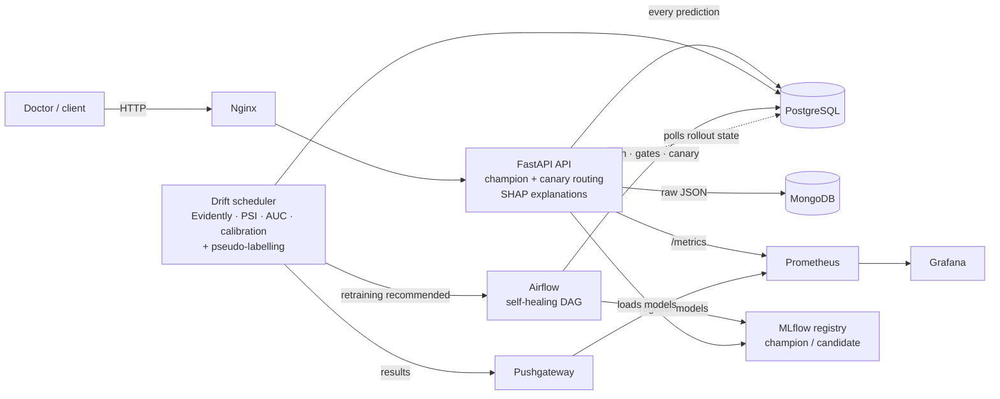
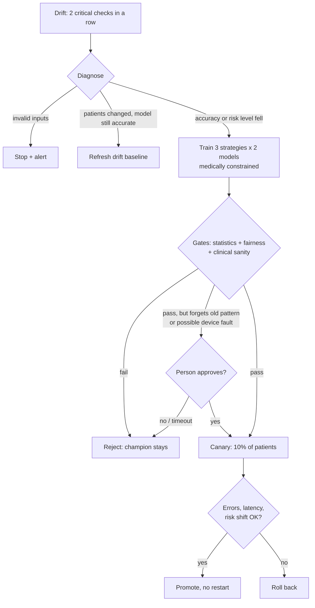

# CardioGuard: self-healing ML monitoring for cardiovascular risk

A complete, production-style MLOps system around a cardiovascular-disease risk model. It serves
and **explains** predictions, **detects drift**, **labels** unconfirmed patients with
semi-supervised learning, and **repairs itself**. When a model degrades, it diagnoses what kind
of drift it is, retrains with several strategies, checks the new model statistically *and
medically*, tries it on 10% of patients, then promotes or rolls it back, with a person in the
loop when the decision is risky.


> Built as the system for an IEEE paper on self-healing machine-learning systems.
> Dataset: [Kaggle Cardiovascular Disease dataset](https://www.kaggle.com/datasets/sulianova/cardiovascular-disease-dataset) (70,000 patients, 11 features).

---

## What it does

| | Capability | How |
|---|---|---|
| 🩺 | **Risk prediction + explanation** | LightGBM (ROC-AUC 0.80) behind FastAPI; SHAP shows *why* for every patient |
| 📉 | **Drift detection** | Evidently (Wasserstein / Jensen–Shannon), PSI, prediction drift, confidence, AUC with bootstrap CI, **calibration** |
| 📊 | **Observability** | Prometheus metrics, 15 alert rules with unit tests, a 42-panel Grafana dashboard |
| 🏷️ | **Semi-supervised learning** | Pseudo-labels only when self-training *and* label spreading agree confidently |
| 🔁 | **Self-healing** | Airflow pipeline: diagnose → retrain (6 candidates) → gates → human approval → canary → promote / roll back |
| 🛡️ | **Medical safety** | Monotonic constraints (risk can't fall as BP rises) + "golden patients" clinical sanity gate |
| 🐳 | **One command** | 15 services in Docker Compose; images on [Docker Hub](https://hub.docker.com/u/harsith27) |

## Architecture



**The self-healing loop:**



## Quick start

**Prerequisites:** Docker Desktop (8 GB RAM recommended) and the dataset.

```bash
git clone https://github.com/harsith27/cardioguard.git
cd cardioguard
cp .env.example .env                      # Windows: copy .env.example .env

# 1. Put the Kaggle file in data/raw/ (cardio_train.csv or .xlsx), then train the base model
docker compose build api
docker compose --profile tools run --rm trainer sh -c \
  "python -m training.data_prep --input data/raw/cardio_train.csv && python -m training.train --monotone"

# 2. Start everything (the first start registers the model in MLflow)
docker compose up -d
```

| Open | What |
|---|---|
| http://localhost:8000 | Risk check with SHAP explanation |
| http://localhost:8000/monitoring | Drift checks, pseudo-labels, **self-healing panel** (approve / reject / roll back) |
| http://localhost:3000 | Grafana (admin / admin) |
| http://localhost:5000 | MLflow models and runs |
| http://localhost:8080 | Airflow (admin / admin) |
| http://localhost:9090 | Prometheus |

**Using the published images instead of building:**

```bash
export DOCKERHUB_USER=harsith27           # PowerShell: $env:DOCKERHUB_USER = "harsith27"
docker compose -f docker-compose.yml -f docker-compose.hub.yml up -d
```

Then follow the **[demo walkthrough](docs/demo.md)** to see drift, retraining and a canary
release end to end in about 20 minutes.

## Key results

**Base model** (test set, 10,190 patients): LightGBM, **ROC-AUC 0.802**, recall 0.70. About
0.80 is the usual ceiling for these 11 features. With medical monotonic constraints the AUC is
0.801.

**Semi-supervised learning** (agreement filter vs supervised only, test ROC-AUC):

| Labelled share | Supervised | Agreement filter | Gap to full supervision recovered |
|---|---|---|---|
| 1% | 0.745 | **0.769** | 42% |
| 5% | 0.764 | **0.785** | 54% |
| 10% | 0.781 | **0.794** | 60% |

**Self-healing** (`python -m mlops.experiment`):

| Drift scenario | Before (statistical gates only) | After (+ medical constraints + clinical gate) |
|---|---|---|
| Flipped labels (medically impossible) | Picks a model with **9–10 clinical failures**; only a human can stop it | Refuses the impossible rule; **0 failures**, keeps old-world AUC 0.79 |
| New guideline (diagnosis at BP ≥ 130/80) | Calibration fixed, but **3 clinical failures**, auto-promoted | Brier 0.223 → **0.163**, **0 failures**, auto-promoted via canary |
| Detection of the guideline drift | AUC check: **no alarm** (0.806) | Calibration check: **critical** (73% sick vs 50% predicted) |

End to end in Docker, the guideline drift was detected and retrained (6 candidates), passed 18/18
clinical checks, ran as a canary on 266 patients and was promoted with no restart. The risk gap
on new patients shrank from 22 to 7 percentage points.

More in [docs/06-self-healing.md](docs/06-self-healing.md) and [docs/05-semi-supervised.md](docs/05-semi-supervised.md).

## Documentation

| Doc | Contents |
|---|---|
| [Demo walkthrough](docs/demo.md) | Step-by-step: normal traffic → drift → automatic retraining → canary → promotion |
| [1. Prediction service](docs/01-prediction-service.md) | Data cleaning, model comparison, API, SHAP, storage |
| [2. Drift monitoring](docs/02-drift-monitoring.md) | Checks, thresholds, simulation scenarios, results |
| [3. Observability](docs/03-observability.md) | Metrics, alerts, Grafana, fault injection |
| [4. Containerization](docs/04-containerization.md) | Services, images, scaling |
| [5. Semi-supervised learning](docs/05-semi-supervised.md) | Agreement filter, experiment, production results |
| [6. Self-healing](docs/06-self-healing.md) | Diagnosis, strategies, gates, clinical safety, canary, results |
| [Configuration](docs/configuration.md) | `.env`, thresholds, pipeline settings |
| [Troubleshooting](docs/troubleshooting.md) | Problems met while building this, and their fixes |

## Project structure

```
app/                 FastAPI service, prediction + monitoring pages, canary routing, /deployment API
common/              shared feature engineering, SHAP explainer, .env loading
training/            data cleaning, model training (incl. --monotone), reference data
monitoring/          drift checks (Evidently, PSI, AUC, calibration), scheduler, alerts, metrics push
semisup/             pseudo-labelling (self-training + label spreading), experiments
mlops/               self-healing pipeline, MLflow registry, rollout state, clinical checks, experiment
dags/                Airflow DAG cardio_self_healing
simulate/            traffic simulator with drift scenarios, load test
infra/               Prometheus rules + tests, Grafana dashboards, Nginx, Postgres init
docker/              Dockerfiles (app, MLflow, Airflow)
tests/               71 tests (pytest)
reports/             SHAP figures, SSL and self-healing experiment results
```

## Development

```bash
python -m venv venv && source venv/bin/activate      # Windows: venv\Scripts\activate
pip install -r requirements.txt
pytest -q                                            # needs data/processed + models/ (step 1 above)
python -m mlops.pipeline --force --canary-minutes 2  # the self-healing steps without Airflow
```

## Tech stack

FastAPI · scikit-learn · LightGBM · XGBoost · SHAP · Evidently · PostgreSQL · MongoDB ·
Prometheus · Grafana · MLflow (skops models) · Apache Airflow 3 · Nginx · Docker Compose

## Citation

If you use this project, please cite it (paper reference to be added):

```
Harsith, "CardioGuard: A Self-Healing Machine Learning Monitoring System with Clinical Safety Gates," 2026.
https://github.com/harsith27/cardioguard
```

## License

[MIT](LICENSE). The dataset is not included; download it from Kaggle under its own terms.
